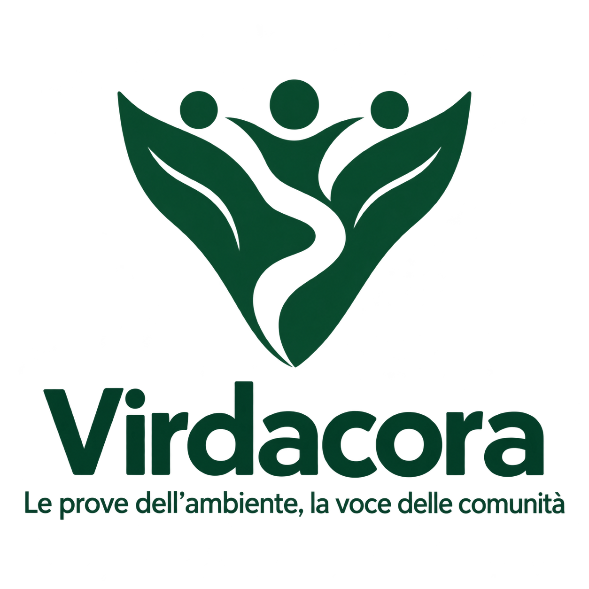

# Virdacora: identità e continuità / identity and continuity

## Italiano

**Virdacora — Le prove dell’ambiente, la voce delle comunità.**

Il progetto cambia nome, mantenendo la missione originale: osservazioni e
analisi ambientali verificabili, coordinamento distribuito, resistenza alla
manipolazione, interventi con risultati controllabili e potere decisionale
delle comunità coinvolte e dei giovani. La tesoreria conserva i propri vincoli;
il token sperimentale non compra il voto ambientale.

Il simbolo unisce foglie, tre figure e un fiume in una V. È una proposta raster
generata con imagegen, non una tavola vettoriale o una garanzia di esclusività.
Il nome è di fantasia: verde/natura e coro/comunità sono associazioni creative,
non un'etimologia linguistica attestata.

File disponibili: [simbolo](assets/virdacora-symbol-v1.png) e
[logo completo](assets/virdacora-logo-v1.png), entrambi PNG con trasparenza.
Le condizioni d'uso sono in [TRADEMARK_POLICY.md](../TRADEMARK_POLICY.md).

L'indirizzo adottato è [atlas-devlab/virdacora](https://github.com/atlas-devlab/virdacora).
La repository torna pubblica con la nuova licenza e i limiti documentati. Il nome pubblico e la comunicazione vengono
aggiornati; copie storiche, dati e prove conservano la propria provenienza.

### Perché alcune stringhe tecniche restano TerraVoce

`@terravoce/*`, i percorsi dello skill e gli identificatori `terravoce-*`,
`urn:terravoce:*`, `TERRAVOCE_*`, `TerraVoce/OpenAutonomy/v1` e
`TerraVoce.EvidenceCandidate.v1` sono identificatori di compatibilità del
prototipo. Non sono il nome pubblico attuale. Alcuni entrano in hash,
firme, metadati e prove già archiviate. Non vengono sostituiti per un cambio
grafico: farlo senza una migrazione versionata romperebbe le verifiche.

Restano conservati anche la licenza MIT precedente, i registri di esperimenti,
le versioni dei modelli, i dati originali e le intestazioni di copyright.
Il nome ERC-20 sperimentale esistente è un identificatore storico; non viene
presentato come un token Virdacora lanciato o venduto. La migrazione di questi
identificatori richiede un lavoro tecnico distinto, con nuove versioni e test.

La bozza di presentazione pubblica è in [LINKEDIN_POST_IT_EN.md](LINKEDIN_POST_IT_EN.md).
Pubblicazione sociale, registrazione del marchio e apertura del codice non
derivano automaticamente dal cambio nome.

## English

**Virdacora — Environmental evidence, a voice for communities.**

The new name preserves TerraVoce's original mission: verifiable environmental
observations and analysis, distributed coordination, resistance to manipulation,
interventions with checkable outcomes, and decision rights for affected
communities and young people. Treasury safeguards remain; the experimental
token does not buy environmental voting power.

The emblem combines leaves, three figures and a river into a V. These are
imagegen-generated raster proposals, not editable vector artwork or a claim
of exclusive rights. Virdacora is an invented name; nature/green and
chorus/community are creative associations rather than an established etymology.

The adopted repository URL is [atlas-devlab/virdacora](https://github.com/atlas-devlab/virdacora).
It is public with the new source terms and documented research limits. The public identity and prose change while historical
evidence, datasets and provenance are preserved.

Package names `@terravoce/*`, the skill paths, protocol identifiers, URNs,
environment variables, signed domains and model versions remain compatibility
identifiers. Some are bound into hashes, signatures and archived verification
metadata. Renaming them needs a separately versioned technical migration;
branding changes must not invalidate evidence. The old experimental ERC-20
name is retained and is not described as a launched Virdacora token.

The earlier MIT license and specific MIT/Apache notices remain valid.
Logo use follows [TRADEMARK_POLICY.md](../TRADEMARK_POLICY.md); source terms
follow [LICENSE_POLICY.md](../LICENSE_POLICY.md).

