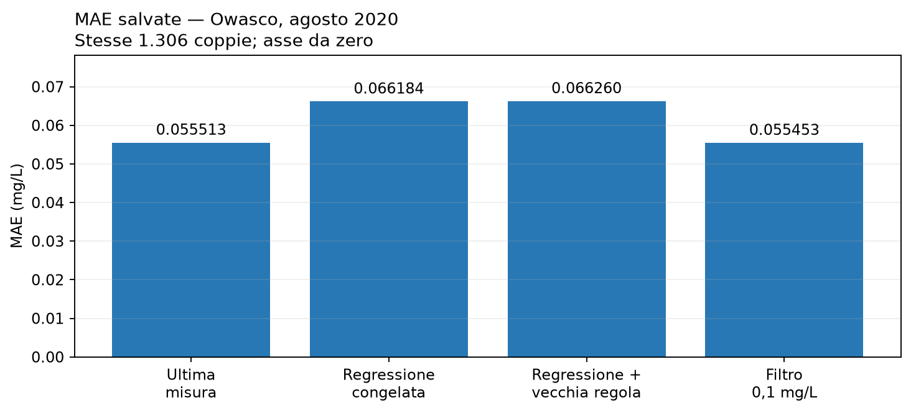

# Owasco: due verifiche, due domande / Two tracks, two questions

## Risultato

Il filtro non dimostra ancora un miglioramento affidabile della previsione
dell'ossigeno a un'ora. La nuova finestra di agosto presenta un piccolo guadagno
medio osservato, ma non supera il criterio congelato di incertezza. Il risultato
originario di luglio resta invariato.

Questa ricerca sostiene lo scopo di Virdacora: evidenze ambientali verificabili e
comprensibili per le comunità. Non modifica Oracle operativo, consenso,
governance, fondi, token o interventi automatici.

## A. Dove si accumulava l'errore di luglio

La [diagnostica](evidence/owasco-gain-diagnostic/diagnostic.json) usa soltanto le
1.275 previsioni e osservazioni bersaglio già salvate. Il
[protocollo adottato](datasets/owasco-gain-diagnostic/protocol.json) fissa le fasce
prima del loro calcolo, ma dopo aver già esaminato il mese. È una descrizione del
campione aperto, non una nuova validazione.

`P` è l'ultima misura mantenuta, `R` la regressione congelata e `F` il filtro.
L'ampiezza è `abs(R-P)` e il guadagno è
`abs(P-bersaglio)-abs(R-bersaglio)`: positivo significa meno errore per R.

| Ampiezza della correzione, mg/L | Coppie | Guadagno medio nella fascia, mg/L | Contributo al guadagno globale, mg/L |
|---|---:|---:|---:|
| [0; 0,025) | 837 | -0,0065284473 | -0,0042857337 |
| [0,025; 0,050) | 328 | -0,0135901549 | -0,0034961340 |
| [0,050; 0,075) | 80 | -0,0181801005 | -0,0011407122 |
| [0,075; 0,100] | 26 | -0,0270185945 | -0,0005509674 |
| oltre 0,100 | 4 | -0,0081897284 | -0,0000256933 |

Ogni fascia ha un guadagno medio negativo in questo mese: R introduce in media
più errore di P. Non significa che ogni singola correzione sia sbagliata, né che
ogni possibile filtro debba fallire. Non abbiamo cercato altre fasce o soglie.

I contributi globali dividono le somme per **1.275**, mentre le medie interne
dividono per il numero di coppie della fascia. Il filtro originale usa P nelle
prime quattro fasce e R soltanto nell'ultima: evita 1.271 correzioni ma conserva
due vittorie e due sconfitte. Il contributo dell'ultima fascia ricostruisce
il guadagno negativo del filtro di luglio, entro la tolleranza
dichiarata. Le due vittorie hanno storie sovrapposte.

Le celle vuote hanno media `null`, non zero inventato. I gruppi
"bersaglio pubblicato invariato/cambiato" usano il risultato futuro e restano
descrittivi: non sono variabili utilizzabili all'origine della previsione.

## B. Nuovo periodo temporale, stesso modello

La [valutazione di agosto](evidence/owasco-temporal-validation/evaluation.json)
usa USGS-425327076313601, le stesse due serie superficiali di ossigeno e
temperatura, dal **1 agosto 2020 00:00 UTC al 29 agosto 2020 00:00 UTC**.
È il mese di calendario successivo; non è una finestra strettamente contigua
all'ultima data del precedente intervallo 1–29 luglio.

Il [protocollo](datasets/owasco-temporal-validation/protocol.json), l'adattatore
e i test sono stati congelati e pubblicati nel commit
`3715d25fce3083b6152ae26c4cc37769719abfc5` prima dell'acquisizione.
Il tentativo esclusivo ha effettuato una richiesta per variabile, senza retry,
redirect o periodo sostitutivo. Entrambe hanno risposto HTTP 200; corpi originali,
compressioni, orari e hash sono nel
[manifest](datasets/owasco-temporal-validation/manifest.json).

Sono presenti **1.306 coppie valide su 1.332 origini attese**, circa 98,05%:
questa è completezza sulla griglia, non accuratezza previsionale. Due origini
mancano; altre 24 non hanno l'intera storia o il bersaglio esatto richiesto.
Nessuna interpolazione locale è stata aggiunta.

Pesi, standardizzazione, otto ingressi, orologio UTC e soglia assoluta 0,100 mg/L
sono invariati. L'uguaglianza alla soglia rimane inattiva. Ogni bersaglio è
esattamente 3.600 secondi dopo l'origine.

| Metodo | MAE luglio, mg/L | MAE agosto, mg/L |
|---|---:|---:|
| P: ultima misura | 0,0386666667 | 0,0555130168 |
| R: regressione senza filtro | 0,0481659072 | 0,0661835497 |
| F: regressione con filtro | 0,0386923599 | 0,0554533862 |

Meno errore è meglio. Ad agosto il guadagno `MAE(P)-MAE(F)` è
**+0,000059630669 mg/L**. F cambia P in 16 casi: otto vittorie e otto sconfitte,
con dimensioni diverse. La percentuale di vittorie da sola non determina la MAE.
Luglio e agosto non sono stati aggregati per sostituire gli esiti separati.

Il successo richiedeva: almeno 1.000 coppie **e** almeno 90% delle 1.332 origini
(insieme almeno 1.199 coppie), previsioni filtrate finite/non negative, MAE
inferiore a P e limiti inferiori del guadagno positivi, oltre la tolleranza
1e-9 mg/L, in **tutti** i tre ricampionamenti accoppiati. Seed base 20261015,
5.000 iterazioni e regole restano quelle originarie.

| Blocco | Intervallo esplorativo 95% del guadagno, mg/L |
|---|---:|
| 48 ore | [-0,0005280386; +0,0005436092] |
| 24 ore | [-0,0003879191; +0,0004821956] |
| 72 ore | [-0,0003173335; +0,0004763213] |

Tutti attraversano lo zero. L'esito congelato è **`inconclusive-gain`**:
piccolo vantaggio nel campione, senza dimostrazione del miglioramento richiesto.
Gli intervalli sono condizionati ed esplorativi; non sono intervalli della
prossima misura, una garanzia di copertura, equivalenza o utilità ecologica.



Il [notebook eseguito](notebooks/owasco-two-track.ipynb) presenta tabelle,
controlli degli hash e grafico usando soltanto le ricevute salvate. Contiene
nove celle di codice eseguite senza errori, con ingressi relativi al repository
e kernel pubblico Python 3. Non acquisisce osservazioni, addestra modelli o
ricalcola previsioni. Il grafico include anche il precedente fallback piatto
come confronto diagnostico; la decisione primaria riguarda F rispetto a P.

## Che cosa hanno fatto gli LLM

La ricerca sulle capacità documentate di Gemini ha individuato
[gestione di contesti lunghi](https://ai.google.dev/gemini-api/docs/long-context),
[ricerca con attribuzione delle fonti](https://ai.google.dev/gemini-api/docs/google-search)
e [esecuzione Python](https://ai.google.dev/gemini-api/docs/code-execution).
Sono funzioni documentate dell'API: non dimostrano superiorità generale rispetto
ad altri modelli né attestano ogni funzione della chat usata.

Gemini, osservato nella chat con **Argon / Alta**, ha ricevuto un compito
circoscritto prima dei nuovi dati: verificare fonti USGS, identità delle serie,
metadati e limiti di disponibilità all'origine. Ha dichiarato accesso parziale
alla pagina indice e agli estratti indicizzati, senza poter leggere direttamente
il corpo completo e la tabella del rapporto richiesto. Il contributo è quindi
parziale; non è una verifica indipendente delle letture o delle prestazioni.

Codex ha verificato le proposte. La premessa che EXO3 non esistesse è stata
smentita dal [produttore YSI](https://www.ysi.com/exo3) e ritirata. Una dichiarata
impossibilità matematica è stata ristretta distinguendo distribuzione ideale
del bootstrap e stima Monte Carlo finita, mediante un controesempio interamente
sintetico. Non sono stati modificati criteri, esclusioni o classi di esito per
accogliere quelle proposte. DeepSeek non è stato usato o integrato.

Il contributo utile conservato riguarda soprattutto i limiti: identità della
serie non prova continuità dello stesso numero di serie fisico; `Approved` non
prova che il valore fosse già disponibile identico al tempo di previsione.
L'accordo successivo alle obiezioni è informato dal dialogo, non una seconda
validazione indipendente. I revisori locali appartengono alla stessa famiglia
Codex. Questa collaborazione assistita non aggiunge un LLM al consenso operativo.

## Limiti ambientali e integrità

Il modello Willamette del 2024 viene applicato ad archivi finalizzati del 2020.
È ricerca retrospettiva sullo stesso sito, fornitore e livello nominale, in due
finestre estive: non una prova live, stagionale completa o con sensori indipendenti.
Il catalogo dice "Depth at 3 feet"; il
[rapporto USGS](https://pubs.usgs.gov/publication/sir20245010/full) descrive 0,76 m.
L'origine della differenza non è dimostrata. La risoluzione nominale, l'accuratezza
del sensore e i decimali pubblicati non sono la stessa cosa. I controlli della
fonte possono includere revisioni a monte; non abbiamo identificato quali
singole letture siano state corrette o quando.

I 14 file storici congelati e la valutazione originale di luglio sono rimasti
invariati. Sono stati aggiunti due script separati con replay offline e test
sintetici. Prima del freeze sono stati normalizzati a LF soltanto i nuovi file,
aggiornandone i pin: i protocolli JSON non sono cambiati semanticamente.
Hash e commit legano artefatti e implementazione; non certificano verità fisica,
calibrazione, benefici ecologici o resistenza a manipolazioni statali.

## Riproduzione offline

Dal root del repository, con Python standard; nessuna rete o nuovo training:

```sh
python -B -m unittest discover -s scripts -p 'test_*.py' -q
python scripts/owasco_gain_bins.py --input docs/evidence/owasco-lake-transfer/evaluation.json --protocol docs/datasets/owasco-gain-diagnostic/protocol.json --verify-report docs/evidence/owasco-gain-diagnostic/diagnostic.json
python scripts/owasco_temporal_validation.py verify --report docs/evidence/owasco-temporal-validation/evaluation.json
```

La suite Python completa ha superato **136 test**, di cui 26 nuovi sintetici.
Le due ricevute sono state riprodotte offline. Il comando `capture` è
deliberatamente esclusivo: riprodurre i risultati significa verificare gli
archivi conservati, non sostituire l'acquisizione originaria.

Per rieseguire il notebook servono inoltre Jupyter, Matplotlib e un kernel
Python 3. La visualizzazione salvata è già consultabile senza installarli.

## English parallel explanation

Both proposed tracks were implemented without refitting the model or changing
the 0.100 mg/L gate. July's fixed-bin decomposition uses the already inspected
1,275 saved predictions: every reporting bin has negative mean ridge gain, but
this does not prove every individual correction or possible filter must fail.
The original filter keeps only the four corrections above the gate; its original
negative overall result is unchanged. Global contributions use the full cohort
denominator; observed changed/unchanged categories are retrospective only.

The August 1–29 UTC window was fixed before its observations were requested.
Protocol and implementation were committed and pushed at the stated freeze
commit, followed by one exclusive capture per required variable. There are
1,306 eligible pairs out of 1,332 expected origins. Filter MAE is 0.0554533862
mg/L versus persistence 0.0555130168, a gain of 0.000059630669 mg/L. All three
prespecified 48/24/72-hour exploratory gain intervals include zero, so the result
is `inconclusive-gain`, not demonstrated superiority or operational readiness.
Sixteen filtered interventions comprise eight wins and eight losses.

Gemini received a public-method source-review task with Argon / High visibly
selected. Full-text access was incomplete, and unsupported hardware and
finite-bootstrap claims were challenged and narrowed. It did not verify the
August observations or numerical performance. Later agreement is mutually
informed. DeepSeek was not used. The numerical experiment remains reproducible
local code, outside operational LLM consensus or automated interventions.

This is a retrospective 2024-model-on-2020 study on the same USGS series and two
summer windows. It does not establish as-of-origin availability, physical sensor
serial-number continuity, calibrated error distributions, ecological benefits or
hypoxia-warning performance. Source revision histories for individual readings
remain unverified. The old evidence stayed unchanged, and offline replay passed.

The [executed notebook](notebooks/owasco-two-track.ipynb) reads only saved,
hash-bound receipts. All nine code cells completed without errors; repository
relative inputs and a standard Python 3 kernel make it portable. It performs
no acquisition, fitting, forecast scoring or bootstrap. Rerunning it requires
Jupyter and Matplotlib; the saved outputs and figure can be viewed directly.
