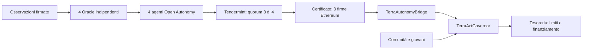

# Ponte Oracle → Open Autonomy → TerraAct

TerraVoce mantiene la missione di coordinare analisi ambientale, interventi e finanziamento attraverso nodi distribuiti, con potere decisionale delle comunità coinvolte e dei giovani. Questo incremento realizza il primo collegamento verificabile tra gli Oracle e il consenso degli agenti. La prova locale non dimostra ancora resistenza alla censura su scala globale: tutti i container condividono un computer.

## Funzionamento



Ogni replica calcola l'assessment attraverso il proprio Oracle, che verifica le firme Ed25519 e applica il modello deterministico e TerraLex. Gli agenti confrontano il risultato con un manifest immutabile, controllano la conversione dell'importo in unità dell'asset e calcolano autonomamente il digest ABI dell'azione. Il manifest è il confine di fiducia della configurazione: regione, policy, snapshot atteso, destinatario, blockchain e scadenza devono essere approvati e distribuiti agli operatori fuori dal canale del relayer.

Le due fasi dell'applicazione ABCI sono `EvaluationRound` (stesso digest da almeno tre agenti) e `SignatureRound` (tre firme distinte sul digest). Il certificato viene esportato dopo il consenso. Chiunque può inoltrarlo al contratto; il relayer non decide l'azione. Il contratto verifica tre operatori di un insieme immutabile di quattro e vincola le firme a chain ID, bridge, Governor, job, scadenza, regione, evidenza, policy, azione, destinatario, importo, reversibilità e metadata. Ogni job può essere presentato una sola volta.

Il bridge può soltanto chiamare `propose`. Non esegue interventi, non muove fondi e non vota nelle camere civiche. La proposta conserva la finestra pubblica di contestazione, la pausa del guardian, la verifica della policy e i limiti della tesoreria. Una contestazione impone il voto delle due camere. Le azioni irreversibili non attraversano questo bridge.

## Prova riproducibile

Requisiti: Docker con container Linux, Node.js 24, pnpm 11.7.0, Git e Python 3.13. Eseguire dalla radice del repository. I comandi seguenti creano solo il runtime locale e usano sensori sintetici e un token di finanziamento simulato.

La [verifica eseguita](../../docs/AUTONOMY_VALIDATION.md) riporta gli esiti e i limiti della prova.

```powershell
python -m venv services/autonomy/.venv
services/autonomy/.venv/Scripts/python.exe -m pip install -r services/autonomy/requirements.txt
services/autonomy/.venv/Scripts/python.exe services/autonomy/prepare.py
pnpm install --frozen-lockfile
pnpm build
docker build -f services/autonomy/Dockerfile -t terravoce-autonomy:local .
docker build -f services/autonomy/Oracle.Dockerfile -t terravoce-oracle:local .
$env:AUTONOMY_PYTHON = (Resolve-Path 'services/autonomy/.venv/Scripts/python.exe').Path
pnpm --filter @terravoce/contracts autonomy:e2e
```

Su Linux usare `services/autonomy/.venv/bin/python` e `export AUTONOMY_PYTHON="$PWD/services/autonomy/.venv/bin/python"`. `prepare.py` recupera due revisioni Git esatte, registra la provenienza e prepara soltanto la chiusura delle dipendenze del servizio. L'avvio verifica le impronte dei pacchetti. I Dockerfile fissano anche i digest delle immagini base.

La prova avvia dodici container: quattro coppie agente/validatore più quattro Oracle. Aspetta che tutti i validatori producano blocchi, spegne due nodi completi e apre il job: nessun certificato deve comparire. Riavvia una rete nuova, spegne un nodo completo e apre lo stesso job: i tre nodi rimasti devono produrre un certificato valido. Il quorum e la potenza dei quattro validatori restano invariati.

Il certificato viene quindi verificato sulla blockchain Hardhat locale: due firme, firme duplicate e importo alterato falliscono; una presentazione valida crea la proposta; una seconda presentazione fallisce. L'esecuzione anticipata è negata. La comunità contesta e approva, mentre la camera dei giovani non approva: la proposta deve risultare respinta e l'esecutore non riceve fondi.

Manifest pubblico, certificati, report e log sono in `services/autonomy/.runtime/scenarios/run-*/`. Le chiavi locali sono nella stessa cartella ma escluse da Git e dal contesto Docker; non copiarle nei report pubblici. I container della prova vengono rimossi a fine scenario senza cancellare volumi o risorse di altri progetti. Non usare mai queste identità di test con fondi reali.

## Limiti e ampliamento coerente con la missione

- Un job immutabile per avvio; non è ancora un servizio continuo con recupero automatico dello stato dopo riavvio. Il gate `start` appartiene alla prova di guasto locale.
- Quattro repliche su un host verificano il guasto di un nodo, non l'indipendenza geografica, amministrativa o di rete. Per distribuirle servono operatori distinti e gestione collettiva di manifest, policy e rotazione delle identità. La rotazione richiede un nuovo bridge e il trasferimento del ruolo di automazione mediante governance.
- L'evidenza viene attestata nel test dalla fixture della blockchain, con il quorum del registro esistente. La pubblicazione distribuita delle attestazioni e l'archivio replicato dello snapshot sono il prossimo collegamento da implementare. Il consenso degli agenti non sostituisce la validità scientifica del modello né prova la verità fisica dei sensori.
- Il modello resta `terravoce-linear-risk-v1`, con soglie illustrative. Non è stato addestrato o validato su dati ambientali reali. Un futuro modello AI può proporre un'azione strutturata, ma dovrà passare gli stessi vincoli deterministici e civici.
- Il finanziamento funzionale resta nel Governor e nella tesoreria; nessuna vendita di token, denaro reale o attuatore fisico è coinvolto nella prova. L'azione dimostrata è `EXTRA_SAMPLING`, riutilizzabile come primo incarico verificabile a un operatore sul territorio.
- Safe e i registri di servizio Olas non sono ancora integrati. Il consenso reale usa Open Autonomy 0.21.29 e Tendermint; il bridge applica direttamente la soglia delle firme Ethereum.

Riferimenti primari: [Open Autonomy](https://github.com/valory-xyz/open-autonomy/tree/v0.21.29), [Open AEA](https://github.com/valory-xyz/open-aea/tree/v2.2.9), [applicazioni FSM](https://stack.olas.network/open-autonomy/key_concepts/fsm_app_introduction/), [modello di minaccia del servizio](https://stack.olas.network/open-autonomy/key_concepts/threat_model/).
